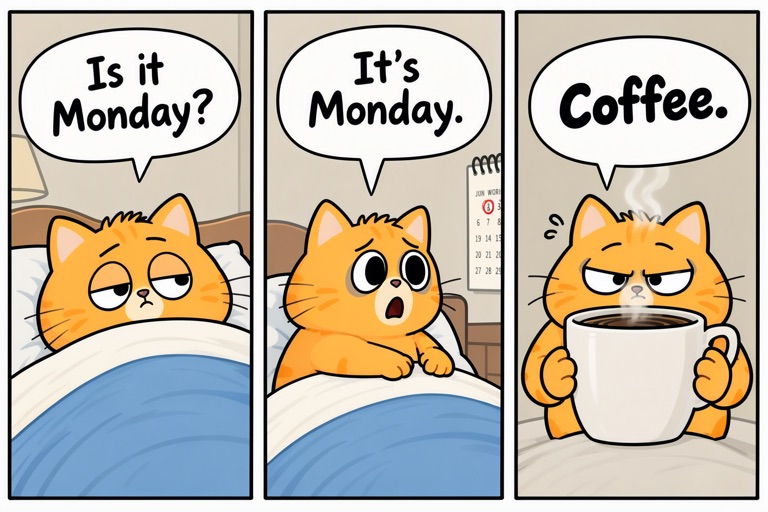

# moss-image-sft

Run [MOSS-Image-SFT](https://huggingface.co/OpenMOSS-Team/MOSS-Image-SFT), OpenMOSS's 5B text-to-image model, on your
own machine. It renders text in images accurately, in English and Chinese, and can place text and objects from a JSON
layout. This repository builds [stable-diffusion.cpp](https://github.com/leejet/stable-diffusion.cpp)'s `sd-server`
from source, downloads quantized GGUF weights and serves an OpenAI-style `POST /v1/images/generations` on loopback:
with Metal on an Apple Silicon Mac, with CUDA on Windows, or on a Windows GPU machine driven from your Mac over SSH.

| [`examples/menu.txt`](examples/menu.txt) | [`examples/bookstore.txt`](examples/bookstore.txt) |
|---|---|
|  |  |
| [`examples/poster.json`](examples/poster.json) (layout) | [`examples/comic.json`](examples/comic.json) (layout) |
|  |  |

Each image is the first try, seed 42, at the default settings below.

| Piece | File | Size |
|---|---|---|
| Transformer | `models/MOSS-Image-SFT-Q8_0.gguf` ([unsloth](https://huggingface.co/unsloth/MOSS-Image-SFT-GGUF)) | 5.5 GB |
| Text encoder | `models/Qwen3.5-9B-Q8_0.gguf` ([unsloth](https://huggingface.co/unsloth/Qwen3.5-9B-GGUF)) | 9.5 GB |
| VAE (FLUX.2 small decoder) and MOSS tokenizer | `models/vae/`, `models/tokenizer/` | 0.27 GB |

All three load onto the GPU: about 15.3 GB (14.2 GiB) of weights plus working memory.

## On a Mac (Apple Silicon)

Needs git, [uv](https://docs.astral.sh/uv/), Python 3 and full Xcode, not only the command line tools: the Metal
build calls `xcrun metal` and `xcrun metallib` to compile sd.cpp's shaders, and those ship only with Xcode.

```bash
./setup.sh                 # once, online: clones ~/dev/stable-diffusion.cpp, builds bin/sd-server, downloads models/
./server.sh                # sd-server on 127.0.0.1:11439 (logs/sd-server.log)
./gen.py "a storefront sign that says \"OPEN 24/7\" in bold clean letters"
./gen.py --prompt-file examples/menu.txt --size 1536x1024
./gen.py --layout examples/poster.json --size 1024x1536
```

Images land in `outputs/`. To browse them newest first, run `python3 -m http.server 8765 --bind 127.0.0.1 -d outputs` and open
`http://127.0.0.1:8765/gallery.html`. Any OpenAI-images client works against `http://127.0.0.1:11439/v1`; native
sd.cpp options ride in the prompt as `<sd_cpp_extra_args>{...}</sd_cpp_extra_args>` (gen.py does this for seed, steps
and negative prompt).

Less memory: `MOSS_QUANT=UD-Q4_K_XL ./setup.sh` (3.4 GB transformer; unsloth's recommended quant, LPIPS 0.21 against
bf16, where Q8_0 scores 0.05).

## On Windows with an NVIDIA GPU

Needs git, uv, Python 3, Visual Studio 2022 with the C++ workload, CUDA 12 with its Visual Studio integration, and
CMake and Ninja on `PATH` (`windows\setup.bat` runs `cmake -G Ninja`).
Clone this repository to `%USERPROFILE%\dev\moss-image-sft`, then:

```bat
windows\setup.bat          :: once, online: builds bin\sd-server.exe for this machine's GPU, downloads models\
windows\server.bat         :: sd-server on 127.0.0.1:11439 (logs\sd-server.log)
python gen.py --layout examples\comic.json --size 1536x1024
```

### Driving it from a Mac

`remote.sh` starts `windows\server.bat` over SSH for one batch, tunnels it to the Mac and stops it afterwards, so
the GPU is only held while images are being made. If it cannot confirm the server stopped, it says so and keeps any
lease. It refuses to start when port 11439 is already in use on that machine. `windows\stop.bat` stops every
`sd-server.exe` running from that checkout, not only this batch's, so run one batch per checkout at a time.
Images land in the Mac's `outputs/`. The Windows machine needs OpenSSH Server and key login.

```bash
REMOTE_HOST=gpu-box ./remote.sh ./gen.py "a storefront sign that says \"OPEN 24/7\""
REMOTE_HOST=gpu-box ./remote.sh bash -c './gen.py --prompt-file examples/fridge_note.txt && ./gen.py --layout examples/layout.json'
```

Settings can also live in a git-ignored `remote.env` beside the script: `REMOTE_HOST`, `REMOTE_DIR` for a checkout
somewhere other than `%USERPROFILE%\dev\moss-image-sft`, and optional `lease_acquire` / `lease_release` shell
functions to hold a GPU lock shared with other jobs. The header of `remote.sh` lists them all.

## Prompts

Plain prompts describe the scene in prose and put any text to render in quotes, with real line breaks where lines
should break ([`examples/menu.txt`](examples/menu.txt), [`examples/fridge_note.txt`](examples/fridge_note.txt)).

Layout prompts are JSON: `summary.caption` describes the whole image and each of `items` has a `label` (`text`,
`object` or `character`), a `caption`, the exact `text` for text items, and a `bbox` as `[y_min, x_min, y_max, x_max]`
in pixels from the canvas centre (`bbox_coord_space: "abs_centralized"`, `bbox_format: "yxyx"`). On a 1024×1024 canvas
both axes run from −512 to 512. Generate at the canvas size the layout was written for. The format is described in
MOSS-Image's [user guide](https://github.com/OpenMOSS/MOSS-Image/blob/main/USERGUIDE.md#layout-prompts-experimental),
and the [examples](examples/) include a poster, a comic strip and a recipe card.

## Defaults

From the model card: flow-matching Euler, 50 steps, CFG 3, shift 5, empty negative prompt, sizes in multiples of 16,
CPU RNG (the same seed gives the same image on Metal and CUDA, up to rounding). Like the reference diffusers pipeline,
sd.cpp skips transformer layer 22 on the negative branch for MOSS.

Measured with Q8_0 at 50 steps: an RTX 4090 takes about 45 s for 1024×1024 and 83 s for 1536×1024; an M5 Max takes
about 6.6 minutes for 1024×1024.

## Notes

- `server.sh` refuses to start if a model file no longer matches `models/SHA256SUMS` or the port is taken.
- `bin/SDCPP_VERSION` records the sd.cpp commit built. Change it with `SDCPP_REF=<commit> ./setup.sh` after removing
  `bin/sd-server` (on Windows, `bin\sd-server.exe` and `windows\setup.bat`).

## Credits and licence

The scripts here are MIT-licensed ([LICENSE](LICENSE)). MOSS-Image-SFT is by the OpenMOSS team and its Qwen3.5-9B
text encoder by the Qwen team, both under Apache-2.0; stable-diffusion.cpp is by leejet and contributors under MIT,
and the GGUF conversions are by unsloth. The VAE is the FLUX.2 small decoder by Black Forest Labs
([black-forest-labs/FLUX.2-small-decoder](https://huggingface.co/black-forest-labs/FLUX.2-small-decoder), Apache-2.0),
and the VAE and MOSS tokenizer are taken from [unsloth/MOSS-Image-SFT-FP8](https://huggingface.co/unsloth/MOSS-Image-SFT-FP8)
at revision `8fb0d8c`, which is Apache-2.0 and carries OpenMOSS's files unchanged. The OpenMOSS and unsloth cards release
their files under Apache-2.0 and thank the Diffusers, Qwen and FLUX teams; neither repository ships a NOTICE file. The weights are
downloaded from Hugging Face, not redistributed here. The sample images were generated with this setup.
